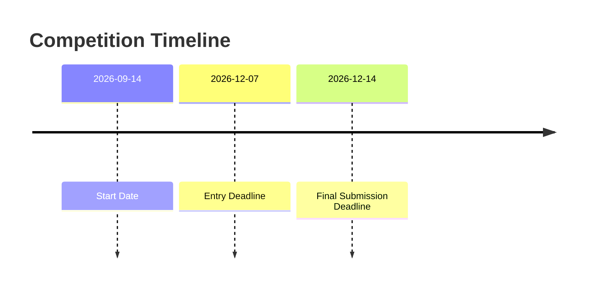

# Enveda-CASMI-2026

## Index
- [Overview](#overview)
- [Timeline](#timeline)
- [Dataset Description](#dataset-description)

## Overview

### Purpose
Help uncover the chemical diversity of nature.  
To build models that predict natural product structures from mass spectra.

### Description
Modern mass spectrometry can detect thousands of molecules in nature, but identifying them all remains a challenge.  
Current method mostly compare spectra against reference libraries. They work for known compounds but struggle with the many unknown molecules found in real biological samples.  
In this competition, you'll build machine learning models that predict 2D chemical structures (a SMILES string) from LC-MS/MS spectra. Your goal is to generate accurate SMILES representations for both **known** and **novel** molecules.

### Background
**What is an MS/MS mass spectrum?**  

- **Ionization**: The instrument can only detect and measure charged ions, so first a molecule is ionized, picking up or losing charged species. In the instrument's **positive ion mode** (more common for small molecules), the resulting ion is positively charged, in **negative ion mode** (less common but still used), it is negatively charged. The kind of charged ion the molecule acquires is called an **adduct**. For some common examples, the molecule may acquire a proton (positive), acquire an ammonium ion (positive), or lose a proton (negative). We would write these adduct forms respectively as [M+H]+, [M+NH4]+, or [M-H]-.

- **Precursor mass detection**: The instrument measures the ion's **precursor m/z** (mass-to-charge ratio) with high accuracy, which strongly constrains the molecular formula. For small molecules, the charge (z) is usually +1 or -1, so m/z corresponds to the mass of the ion, and sometimes we will refer to m/z simply as "mass".

- **Fragmentation**: The precursor ion (actually many individual ions of the same molecule+adduct) is then selected and fragmented by collision with neutral gas at a given **collision energy**, and the instrument records the **m/z and intensity (abundance) of each fragment**. The histogram of intensities across all detected fragments is the molecule's mass spectrum. Intensities are typically normalized. Each m/z is called a **fragment ion or peak** (peaks of individual fragment ions), the **base peak** (highest-intensity fragment ion), the **precursor peak** (m/z corresponding to the intact, unfragmented ion). It may or may not be present, depending on how thoroughly the ion was fragmented.

### Evaluation
Submissions are evaluated using Mean Reciprocal Rank @ 25 (MRR@25):

$$
\text{MRR@25} = \frac{1}{U} \sum_{u=1}^{U} \frac{1}{\text{rank}_u}
$$

*U*: the number of molecules  
*rank<sub>u</sub>*: the position of the first correct structure in your ranked list for molecule *u*  

A molecule score 0 if none of your guesses is correct. Each molecule has exactly one correct structure, so only your **first** correct guess counts.  
A correct guess at position 1 scores 1.0, at position 2 scores 0.5, at position 25 scores 0.04.

### Matching
A prediction is correct when it describes the same **atom connectivity** as the answer.  
Both your SMILES and the answer are passed through RDKit's tautomer canonicalization (pinned at 2026.03.03: standardize multiple molecular structures into a single, designated "representative structure") and reduced to the first block of their InChIKey (the InChIKey14: represents the chemical formula, connectivity, and hydrogen atoms), then compared. The prediction is correct when the two first-block keys match.

This means you are not penalized for getting stereocenters or tautomer forms wrong. For example, regardless of which isomer of glucose it is, it has the same InChIKey14 (WQZGKKKJIJFFOK).

### Submission File
For each `molecule_id` in the test set, predict up to 25 candidate structures as SMILES, **best guess first**, joined by semicolons in a single field.  
Every `molecule_id` must appear exactly once. The file should contain a header and have the following format:

```
molecule_id,smiles
m_0014ef,CC1=CC(=O)C=CC1=O;OC(=O)c1ccccc1O;CN1C=NC2=C1C(=O)N(C)C(=O)N2C
m_004d06,NCCc1ccc(O)cc1;CC(=O)Nc1ccc(O)cc1;OCC(O)CO
... 
```

Fewer than 25 guesses is allowed but there is no penalty for a wrong guess beyond the rank it occupies. A submission is rejected if it is missing the `molecule_id` or `smiles` column, is empty, contains null in either column, repeats a `molecule_id`, or gives more than 25 semicolon-separated guesses for any molecule.

## Timeline



## Dataset Description
This competition focuses on molecules that resemble those found in natural samples from plants, mammals, or microbes--confirmed natural products, hypothesised natural products, natural product analogs, and synthetic molecules that might plausibly occur in nature.  
A molecule may have been measured several times at different collision energies or as different adducts.  
**Predictions are made per molecules, not per spectrum**, so you must aggregate the evidence from all of a molecule's spectra into one ranked list.  

### Files
- train.parquet -- ~2.5m MS/MS spectra covering ~275k unique structures, with the structure given. One row per spectrum.
- test.parquet -- the spectra to identify. One row per spectrum; the structure is not given.
**Note**: the file you see is comprised of examples from the training dataset; it will be replaced by the hidden test set during re-run, and will be approximately the same size.
- sample_submission.csv -- a valid submission in the correct format.

### Test set
~1,500 spectra of ~400 molecules, 1-16 spectra per molecule (median 3), all acquired on a Bruker timsTOF. Monoisotopic masses range from 157 to 1,159 Da (median 348).  

Every scored molecule falls into one of three novelty classes, in order of increasing difficulty:  
|Class|Definition|
|---|---|
|1 -- in public spectral libraries|The structure has publicly available reference MS/MS spectra, so it may be found by similarity to the training spectra.|
|2 -- known structure, no public spectra|No public spectra exist for this molecule, but the structure is in PubChem or the natural-products database COCONUT, so it is reachable by database retrieval.|
|3 -- novel structure|The structure is not in PubChem at all and must be predicted de novo.|
To mimic a real complex mixture, the distribution over clauses -- and which molecule belongs to which class -- is hidden for the duration of the competition.  

The test spectra have had only minimal cleaning applied, because there is no standard way to curate mass spectra and we would rather not discard information on your behalf:

- Spectra whose measured precursor mass was inconsistent with the known structure and adduct were dropped.
- Spectra whose base peak was below 1,000 raw counts were dropped as likely noise.
- Peaks above precursor + 2 Da were removed -- a fragment cannot outweigh its singly-charged precursor.

Test spectra use one of ten adducts: `[M+H]+`, `[M+NH4]+`, `[M-H2O+H]+`, `[M-2H2O+H]+`, `[M+Na]+`, `[M+K]+`, `[M-H]-`, `[M-H2O-H]-`, `[M+CH2O2-H]-`, `[M+Cl]-`. The training set contains many more.

### Columns
Peak lists are stored as two aligned arrays: the i-th m/z pairs with the i-th intensity, with intensities normalised per spectrum so the largest peak equals 1.0. `train.parquet` and `test.parquet` use identical names for the shared columns, so preprocessing code ports directly.

**test.parquet (12 columns)**

|Column|Description|
|---|---|
|`molecule_id`|Anonymous compound identifier. Predictions are made per `molecule_id`.|
|`spectrum_id`|Unique identifier for each spectrum.|
|`ms2_mzs`|Array of fragment m/z values.|
|`ms2_normalized_intensities`|Aligned array of fragment intensities; base peak = 1.0|
|`base_peak_intensity`|Raw intensity of the largest peak before normalisation. More intense spectra usually contain less noise.|
|`adduct`|Precursor adduct, one of the seven above.|
|`ionization_mode`|`positive` or `negative`.|
|`instrument_type`|Always `timsTOF` -- all test spectra share one platform.|
|`precursor_mz`|Measured precursor m/z.|
|`collision_energy_ev`|Collision energy in electron volts, as a list. A single value ([20]) is one acquisition; several ([20, 40, 60, 80]) means the spectrum is merged form acquisition at different energies.|
|`collision_energy_orig`|The collision energy as originally recorded.|
|`collision_energy_orig_units`|Always eV in the test set.|

**train.parquet (18 columns)**
The test columns above plus:

|Column|Description|
|---|---|
|`normalized_smiles`|**The label**. The structure as an RDKit-standardised SMILES string.|
|`inchikey` / `inchikey14`|InChIKey of the structure and its first block, which identifies the 2D skeleton independent of stereochemistry.|
|`molecular_formula`|Formula of the neutral structure.|
|`ingest_lib`|Source library (see below).|
|`adduct_orig`|The adduct string as recorded by the source, before standardisation.|
|`precursor_error_ppm`|ppm error between the measured precursor m/z and the value implied by the labelled structure and adduct. Ships uncleaned, so it doubles as a label-quality signal.|
|`num_peaks`|Number of fragment peaks.|
